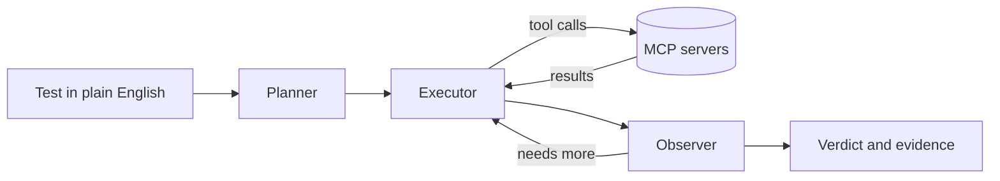

# Tailoop

Describe a test in plain English. Tailoop's agent carries it out against your
application and returns a verdict, with the evidence behind it.

> Tailoop itself is not open source. This repository holds examples and a
> public regression suite that runs the released tool.

## A test is a text file

```text
Web app: https://www.saucedemo.com

Test scenario: Log in as {{USERNAME}} with password {{PASSWORD}}.
Add "Sauce Labs Backpack" to the cart and open the cart.

Acceptance criteria: The cart holds exactly one item, the Sauce Labs Backpack.
```

```sh
tailoop run --file add-to-cart.txt --report-format junit
```

Every run ends in PASS, FAIL or INCONCLUSIVE and exits 0 only on PASS, so it
drops into any CI pipeline. Results are written as JSON and JUnit XML.

## How it works



- **Every backend is an MCP server.** A browser, a Windows desktop, a database,
  an API or your own server, each a few lines of YAML. Several can take part in
  one test.
- **The verdict comes from evidence.** A separate observer judges what the
  tools actually returned, asks for earlier screenshots when it needs them, and
  answers INCONCLUSIVE rather than guess.
- **Credentials never reach the model.** Tests use placeholders such as
  `{{PASSWORD}}`; the real value is filled in at the tool call and masked in
  everything the model sees.

## In this repository

- `tests/` is a public regression suite for Tailoop itself. The folder a test
  sits in is the verdict Tailoop must reach: `pass/` or `fail/`. Tests in
  `fail/` ask for something the application does not do, and the suite only
  passes if Tailoop notices.
- `tailoop.yaml` is the configuration it runs with: headless Chrome, driven
  through [chrome-devtools-mcp](https://github.com/ChromeDevTools/chrome-devtools-mcp).
- `.github/workflows/regression.yml` runs the suite on every Tailoop release and
  once a week. Each run's summary lists every verdict with its reasoning and cost.

## Getting access

Tailoop is built by [Wapice](https://www.wapice.com) and is currently available
to selected teams. Open an issue in this repository to ask about access.
