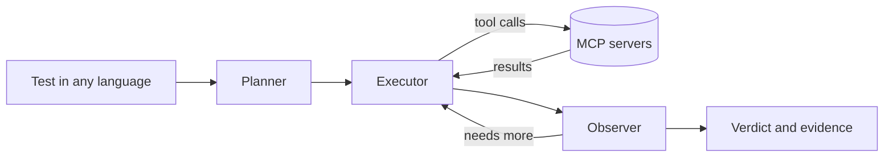

# Tailoop

[](https://github.com/tailoop-dev/tailoop/actions/workflows/regression.yml)
[](https://github.com/tailoop-dev/tailoop/releases)

Describe a test in your own words, in any language. Tailoop's agent carries it
out against your application and returns a verdict, with the evidence behind it.

> Tailoop itself is not open source. This repository holds examples and a
> public regression suite that runs the released tool.

## A test is a text file

```text
Web app: https://www.saucedemo.com

Test scenario: Log in as {{USERNAME}} with password {{PASSWORD}}.
Add "Sauce Labs Backpack" to the cart and open the cart.

Acceptance criteria: The cart holds exactly one item, the Sauce Labs Backpack.
```

```sh
tailoop run --file add-to-cart.txt --report-format junit
```

Every run ends in PASS, FAIL or INCONCLUSIVE and exits 0 only on PASS, so it
drops into any CI pipeline. Results are written as JSON and JUnit XML.

## How it works



- **Every backend is an MCP server.** Browsers, desktop UIs, databases, external
  APIs, and your own applications become available through a few lines of
  configuration. Tailoop picks the right tools from the available servers for
  the test at hand.
- **The verdict comes from evidence.** An independent observer agent evaluates
  how the test execution progressed, uses gathered evidence to draw conclusions,
  and returns INCONCLUSIVE if the provided data is insufficient.
- **Secrets never reach the model.** Tests use placeholders such as
  `{{PASSWORD}}` for sensitive data; the real value is injected into the tool
  calls and removed from everything the model sees.

## In this repository

- `tests/` is a public regression suite for Tailoop itself. The folder a test
  sits in is the verdict Tailoop must reach: `pass/`, `fail/` or
  `inconclusive/`. Tests in `fail/` ask for something the application does not
  do, and tests in `inconclusive/` ask for something no configured tool can
  check. The suite only passes if Tailoop tells each case apart. One test,
  `tests/fail/locked-out-login.txt`, is written in Finnish.
- `tailoop.yaml` gives it two MCP servers: headless Chrome through
  [chrome-devtools-mcp](https://github.com/ChromeDevTools/chrome-devtools-mcp),
  and a filesystem server reading `fixtures/`. `tests/pass/prices-match-fixture.txt`
  uses both in one test.
- `.github/workflows/regression.yml` runs the suite on every Tailoop release and
  once a week. Each run's summary lists every verdict with its reasoning and cost.

**Latest results:** [every run of the suite](https://github.com/tailoop-dev/tailoop/actions/workflows/regression.yml),
newest first. Open one to see the test results.

## Getting access

Tailoop is built by [Wapice](https://www.wapice.com) and is currently available
to selected teams.
